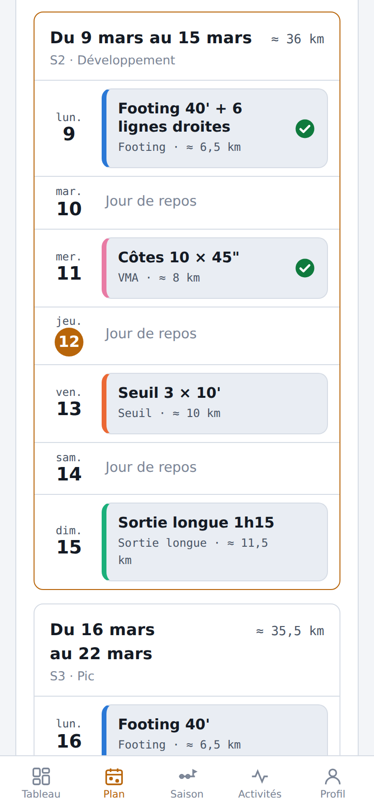
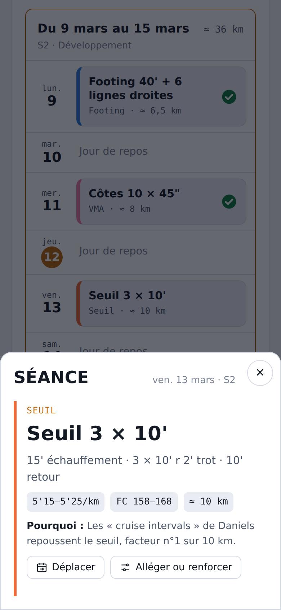
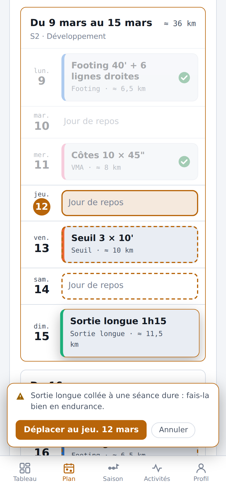
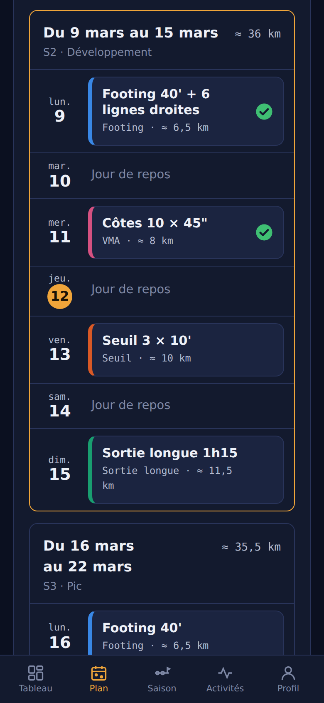
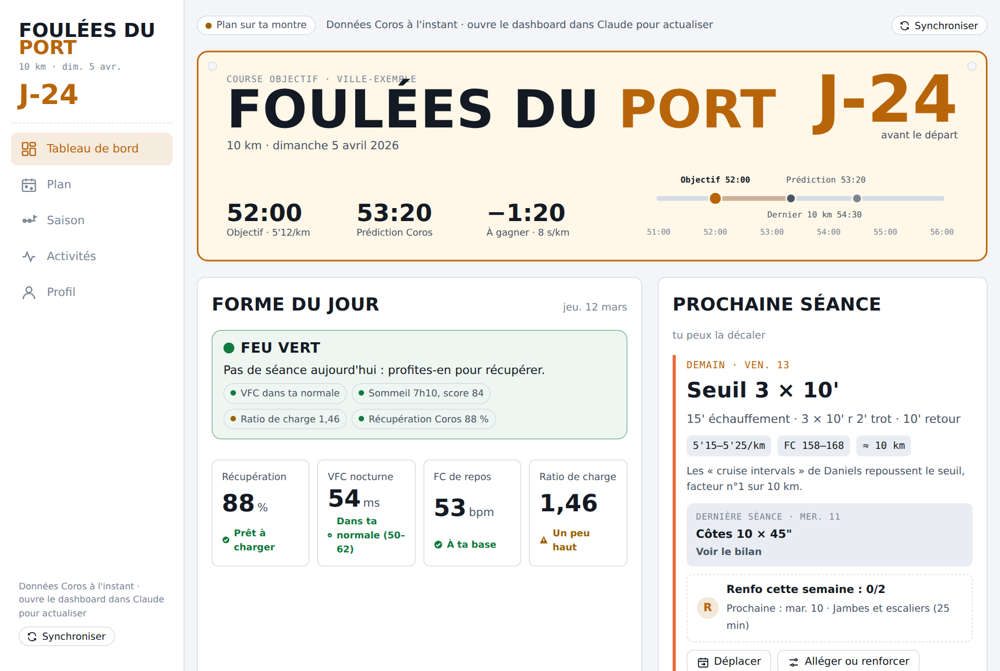
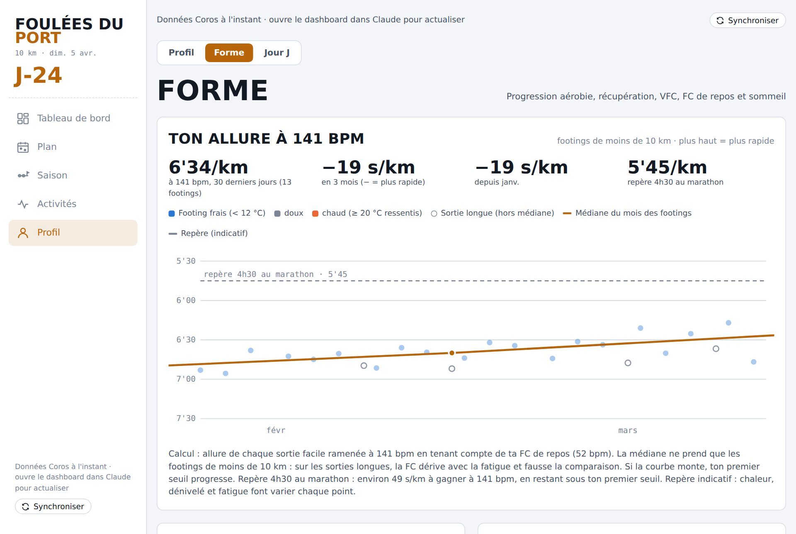
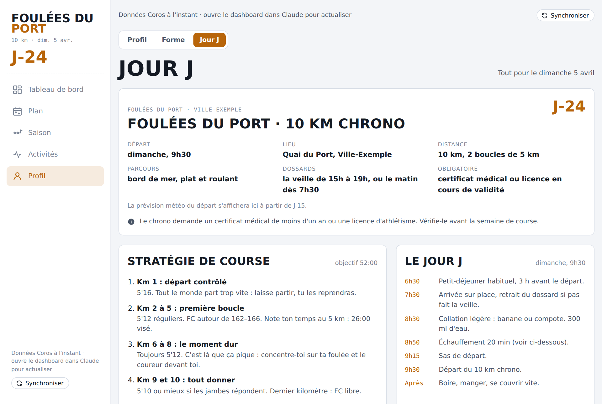

# allure-coach

*Coach de course à pied pour COROS, dans Claude.*

Un coach de course à pied qui tourne dans Claude. Il lit tes données COROS, cale tes zones cardiaques, construit un plan pour ta course, l'envoie sur ta montre, puis te monte un dashboard qui se met à jour tout seul. Tu peux y déplacer ou alléger une séance : la montre suit.

<p align="center">
  
  
  
  
</p>

> **Projet indépendant.** Non affilié à COROS ni à Anthropic. Ce n'est **pas un avis médical** : les plans sont des propositions à adapter à ton ressenti. En cas de douleur, arrête et consulte un professionnel de santé.

## Essayer sans rien installer

Ouvre [`exemples/demo.html`](exemples/demo.html) dans ton navigateur (télécharge le fichier, puis double-clic). C'est le vrai dashboard avec un athlète fictif, Camille, qui prépare un 10 km. La démo ne se connecte à rien : aucune donnée n'est lue ni écrite, et ses dates se calent d'elles-mêmes sur la semaine en cours.

## Ce que ça fait

- **Plan sur mesure** : zones calées sur ta FC au seuil (méthode Friel), allures Daniels, séances variées (fartlek, côtes, seuil, pyramides, allure course), polarisation 80/20, affûtage.
- **Envoi sur la montre** via le connecteur COROS, puis synchro à chaque changement.
- **Calendrier** : touche une séance pour sa fiche, appui long pour la déplacer ou l'échanger avec une autre. Des conseils te préviennent si l'enchaînement devient risqué.
- **Forme du jour** : feu vert, orange ou rouge d'après la VFC, le sommeil, la charge, la récupération et ton ressenti.
- **Alléger ou renforcer** une séance en un geste.
- **Bilan de séance** : prévu contre réalisé, avec ta note et la douleur éventuelle.
- **Progression aérobie** : ton allure à FC fixe, avec l'effet de la chaleur.
- **Facultatif** : météo de tes sorties (Open-Meteo), programme de renfo, fiche Jour J avec prévision du départ, frise de saison, bilan chaque dimanche.

| Tableau de bord | Forme | Jour J |
| --- | --- | --- |
|  |  |  |

## Ce qu'il te faut

- Claude avec **Cowork** (offre payante).
- Une montre **COROS** et le connecteur **Coros** dans claude.ai → Réglages → Connecteurs.
- Facultatif : le connecteur **Open-meteo**.

Testé en octobre 2026. Ces produits évoluent : si un nom d'outil change, adapte `kit/GUIDE-CLAUDE.md` ou ouvre une issue.

## Installation (5 minutes)

1. Dans Claude, crée un projet, par exemple « Course à pied ».
2. Ajoute dans les fichiers du projet les deux fichiers du dossier [`kit/`](kit) :
   - `GUIDE-CLAUDE.md`
   - `coach-dashboard-template.html`
3. Démarre une tâche Cowork dans ce projet et écris : **« Lance le kit coach course »**.
4. Réponds aux questions (course, date, objectif, jours disponibles). Claude te présente tes zones, son diagnostic et le plan avant de l'envoyer sur ta montre.

Conseils :
- Si ta montre contient un plan d'une autre application, retire-le dans l'app COROS : Claude ne modifie que les plans qu'il a créés.
- Ouvre toujours le dashboard **depuis Claude**, pas dans un navigateur : c'est ce qui permet la synchro avec la montre.
- La première fois, Claude te demande d'autoriser l'accès à COROS (et à Open-Meteo) pour cette page.
- Pour ne pas confirmer chaque déplacement, passe l'outil `updateTrainingPlan` du connecteur Coros en « Toujours autoriser ».

## Comment ça marche

Tout ce qui est propre à l'athlète vit dans **un seul objet**, `COACH`, que Claude remplit puis injecte dans le modèle HTML. Le schéma complet est dans [`kit/GUIDE-CLAUDE.md`](kit/GUIDE-CLAUDE.md), un exemple rempli dans [`exemples/exemple-coach.json`](exemples/exemple-coach.json).

```
kit/coach-dashboard-template.html   le modèle (aucune donnée personnelle)
kit/GUIDE-CLAUDE.md                 les instructions que suit Claude, de bout en bout
exemples/exemple-coach.json         un athlète fictif, pour voir à quoi ressemble un COACH
exemples/demo.html                  la démo, générée par scripts/build-demo.py
```

## Confidentialité

- Tes données COROS sont lues par Claude, dans ton compte, via le connecteur. Ce kit n'envoie rien à un autre serveur.
- Le dashboard est un artifact **privé** tant que tu ne le partages pas. Ses données (déplacements, notes, bilans) vivent dans la base de l'artifact, liée à ton compte. Ne partage pas son lien : il contient ton plan, tes zones et tes sorties.
- Requêtes externes de la page : les polices Google Fonts à l'ouverture, Open-Meteo via le connecteur (coordonnées arrondies à environ 1 km), et des liens YouTube dans l'onglet Renfo, ouverts seulement quand tu cliques.
- Quand tu publies une issue ou un exemple, retire ton prénom, tes FC, ton lieu et le lien de ton dashboard.

## Limites connues

- Le renfo reste dans le dashboard : COROS n'accepte que la course à pied, le vélo et le trail via le connecteur.
- Un plan importé d'une autre application n'est pas modifiable depuis le dashboard.
- Un plan démarre dans les 14 jours et dure de 4 à 16 semaines (règle du connecteur). Pour un objectif plus lointain, Claude crée la première partie puis prolonge.
- Les prédictions et les conseils sont des estimations. L'adaptation hebdomadaire dépend de la régularité de tes synchros.

## Références

Seiler (polarisation) · Daniels (VDOT) · Friel (zones à la FC au seuil) · Mujika & Padilla et Bosquet 2007 (affûtage) · Plews et Kiviniemi (VFC) · Blagrove 2018 et Lauersen 2014 (renforcement). Météo : données [Open-Meteo.com](https://open-meteo.com/) (CC BY 4.0).

## Contribuer

Les issues et les pull requests sont bienvenues : voir [`CONTRIBUTING.md`](CONTRIBUTING.md). Pour régénérer la démo après une modification du modèle : `python3 scripts/build-demo.py`.

## Soutenir le projet

Si ce kit t'aide à courir mieux, tu peux m'offrir un café. C'est facultatif et ça ne donne pas droit à un support personnalisé.

[](https://www.buymeacoffee.com/SekiroKost)


## Licence

[MIT](LICENSE). Les marques citées appartiennent à leurs propriétaires.

---

*English version: [README.en.md](README.en.md)*
